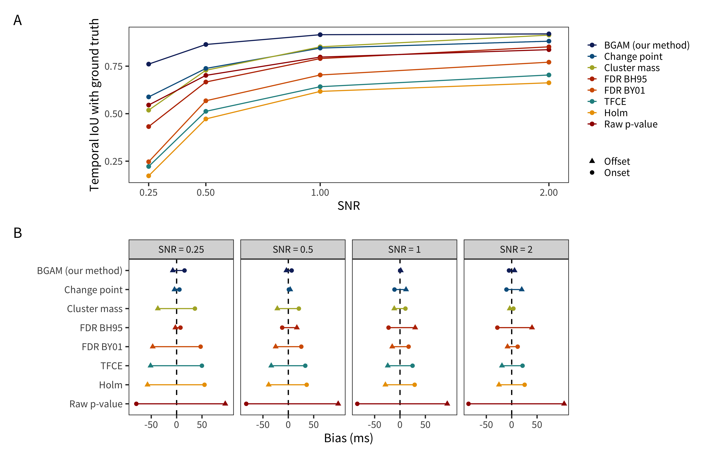
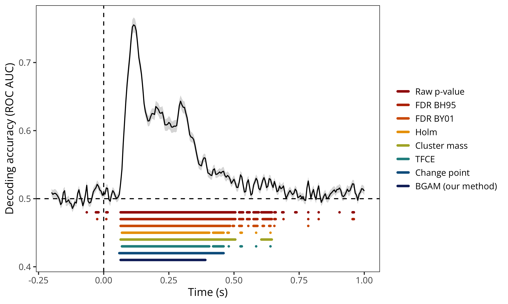
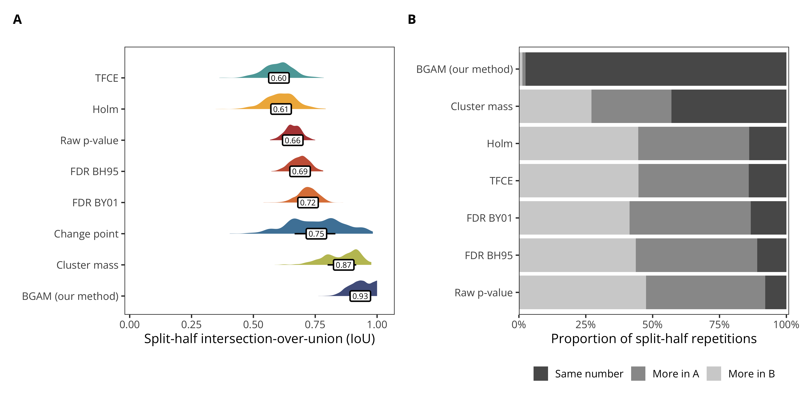

# From clusters to curves: A model-based alternative to cluster-based permutation tests for the analysis of time-resolved data

## Abstract

Time-resolved electrophysiological measurements such as those obtained through magneto- and electroencephalography (M/EEG) offer a unique window onto the neural activity underlying cognitive processes. Researchers are often interested in determining whether and when these signals differ across experimental conditions or participant groups.

The conventional approach involves mass-univariate statistical testing across time and/or space, followed by corrections for multiple comparisons or some form of cluster-based inference. While effective for controlling error rates at the cluster level, cluster-based inference limits what can be concluded about the precise temporal localisation of an effect, including its onset and offset.

Here, we present a model-based alternative for analysing M/EEG time series, such as event-related potentials or time-resolved decoding accuracy. Our approach uses Bayesian generalised additive multilevel models (BGAMMs) to model the temporal trajectory of neural signals while accounting for between-participant variability. Temporal effects are identified using posterior probabilities relative to a baseline-derived effect-size threshold.

Using simulated data with known ground truth, we show that the proposed approach provides accurate recovery of the overall temporal extent and onset of neural effects across a range of signal-to-noise ratios. Offset localisation is comparatively more variable, and some conventional methods perform better on specific offset-error metrics. In an empirical MEG decoding dataset, the BGAM approach also yields the highest split-half temporal overlap among the methods considered and highly stable temporal segmentation across repeated participant splits.

Together, these results illustrate the potential of model-based inference as a complementary approach to conventional cluster-based procedures when temporally localised inference and explicit modelling of between-participant variability are scientifically important.

We provide an open-source `R` package implementing the method and describe how it can be integrated into M/EEG analysis pipelines using `MNE-Python`.

## Main simulation results

We evaluated the methods using simulated EEG data with a known temporal effect across four signal-to-noise ratio (SNR) levels. Performance was quantified using temporal intersection-over-union (IoU), which measures how closely the complete set of detected time points matches the true temporal extent of the effect, together with onset and offset bias, mean absolute error (MAE), root mean squared error (RMSE), and variability across simulations.

Across all SNR levels, the `BGAM` approach achieved the highest median temporal IoU, with the largest advantage at lower SNRs. It also provided comparatively accurate onset localisation. Offset localisation was more variable: BGAM showed low average offset error, but cluster-mass inference achieved lower offset RMSE in several conditions, indicating fewer large offset errors.



Overall, these results suggest that BGAM provides particularly accurate recovery of the **overall temporal extent** and **onset** of simulated effects, while its advantage is less consistent for offset localisation.

## Application to empirical MEG data

We also applied the methods to empirical time-resolved MEG decoding data from 32 participants. The figure below shows the group-level average decoding performance over time together with the temporal intervals identified by each method.

The `Raw p-value` and `FDR BH95` procedures produced the most temporally extensive and fragmented detections, including intervals before stimulus onset and several late detections beyond the main decoding response. The more conservative multiplicity-corrected and cluster-based procedures (`FDR BY01`, `Holm`, `Cluster mass`, and `TFCE`) identified a broadly similar main period of above-chance decoding, beginning at approximately 50-60 ms, although some methods additionally yielded shorter later clusters.

In contrast, the `Change point` and `BGAM` procedures produced comparatively compact and contiguous temporal intervals.



Thus, the methods broadly agreed on the onset of the main decoding effect but differed substantially in its estimated duration and degree of temporal fragmentation.

## Split-half reliability

To evaluate the stability of the temporal detections in the empirical dataset, we performed 1,000 repeated random split-half analyses of the 32 participants.

BGAM showed the greatest temporal overlap between independently analysed halves of the sample, with a median IoU of **0.93**, followed by cluster mass (**0.87**) and change-point detection (**0.75**). `BGAM` also showed highly consistent temporal segmentation, with the two halves yielding the same number of detected intervals in almost all repetitions.



These results provide a complementary assessment of empirical stability when the true temporal effect is unknown.

## Usage

For users who are already familiar with `brms`, the recommended workflow is to import ERP, decoding, or other time-resolved M/EEG estimates into `R` and fit the model directly using the code provided in the manuscript and repository.

Alternatively, the [`neurogam`](https://github.com/lnalborczyk/neurogam) R package provides higher-level functions implementing the same general workflow with sensible defaults. For example:

```r
library(neurogam)

gam_results <- testing_through_time(
    data = df,
    participant_id = "participant",
    meeg_id = "eeg",
    time_id = "time",
    predictor_id = "condition",
    threshold = 10
    )
```

The framework can also be extended to multidimensional settings, including cross-temporal generalisation matrices and spatio-temporal M/EEG analyses.

## Software

The method is implemented in the open-source [`neurogam`](https://github.com/lnalborczyk/neurogam) `R` package. The manuscript additionally provides examples of interoperability with `MNE-Python`, allowing M/EEG preprocessing to be performed in Python before carrying out model-based inference in `R`.
